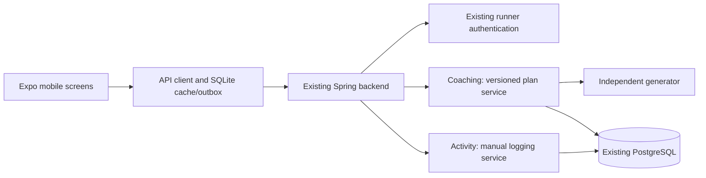

> Current release: the user switched to a website integrated into Hermes. See [web-delivery.md](web-delivery.md) for implementation scope; mobile choices below remain proposals.

# Architecture: Hermes mobile running-plan experience

Date: 2026-10-13. Inputs: `recon.md` and `features.csv` in this directory. Scope: independently authored iPhone/Android experience for 5K/10K setup, plan preview, today's session, and manual logging. GPS recording follows later.

This is a proposed architecture, not implemented functionality. The companion `schema.sql` is additive PostgreSQL DDL for review and isolated validation, not a command to run on the current Hermes database. All 44 feature statuses remain `no` because this stage builds no product code.

## Stack decisions

| Layer | Choice | Why |
| --- | --- | --- |
| Mobile | New `mobile/` app: Expo, React Native, TypeScript, Expo Router | Shares one phone codebase and fits Hermes's existing React skills. Native screens use React Native components, not browser DOM/CSS. |
| UI | Native primitives, a small token/component library from replica-design | Supports platform accessibility and one coherent original visual language. |
| Backend | Existing Spring Boot 4.1.1 / Java 17 monolith | Preserve runner identity, activities, email, and deployment; add versioned planning within the existing domain. Versions quoted from current `backend/pom.xml`, not a recommendation to upgrade. |
| Persistence | Existing PostgreSQL database; Spring Data JPA/JDBC | One server database. Existing H2 development remains supported through equivalent mappings/migrations. |
| Auth | Existing Hermes opaque bearer sessions; SecureStore on phone | Reuses account rules without creating a second identity system. Session limitations below are release decisions. |
| Local persistence | Expo SQLite for owner-scoped drafts, cached reads, and a manual-log outbox | Retains pending entries through restart. SQLite is a device cache, not another server system of record. |
| Email | Existing Hermes mail transport, configured for Resend | Reuse verification/reset flows; no new email provider account required for planning. |
| Generation | Deterministic Java planner interface with versioned independent rules | Can first return labeled synthetic fixtures, then reviewed prescriptions. No Runna endpoint or model dependency. |
| Jobs | Existing Spring scheduler; generation initially synchronous and bounded | Fewer moving parts; expired command receipts need a small cleanup task. |
| Hosting/build | Existing backend hosting configuration; EAS Build for signed mobile binaries | Build both native clients; hosting-account state was not verified. |
| Payments/files | Deferred; existing Stripe is not extended in this release | No subscriptions or media library in the core loop. |

Choose and lock the supported stable Expo template/SDK at implementation time, then use Expo's installer to align native package versions. Do not copy the web frontend's React dependency versions into mobile. [Expo build documentation](https://docs.expo.dev/build/introduction/)

EAS can build iOS in the cloud from Windows, with testing on a physical iPhone; a local iOS simulator needs macOS. Android can use a local emulator or device. Background location requires an appropriately configured development build and permissions; Expo Go is insufficient for that stage. No claim is made that signing credentials or a build account already exist. [Expo FAQ](https://docs.expo.dev/faq/), [location requirements](https://docs.expo.dev/versions/latest/sdk/location/)

## Reuse verified in this checkout

This is a narrow source inspection, not a full feature audit. These local files establish integration boundaries:

| Existing code | Finding | Architectural consequence |
| --- | --- | --- |
| `backend/src/main/java/com/hermes/backend/runner/Runner.java` | `Long` identity; token hash and issue time on the runner | Reference `runner.id` as bigint; do not create a duplicate users table. |
| `backend/src/main/java/com/hermes/backend/auth/AuthService.java` | One opaque bearer token per runner; issuance replaces it; ordinary sessions have a 30-day limit | Phone login can invalidate web login. Initial prototype explicitly accepts this. Multi-device sessions require a separately scoped auth change before a general mobile release. |
| `backend/src/main/java/com/hermes/backend/auth/LoginController.java` | Signup, login, verification, recovery, logout; signup allows email/password/captcha token | Use current request shapes. Signup may require verification; do not assume it always returns a usable session. |
| `backend/src/main/java/com/hermes/backend/runner/ProfileController.java` | `GET /api/profile/me` | Reuse authenticated identity check; new plan preferences get a separate DTO. |
| `backend/src/main/java/com/hermes/backend/activity/ActivityCoreFields.java` | Existing bigint activity ID, distance and duration fields, provider and legacy wall-time storage | New manual logging writes existing activities via an adapter and keeps an authoritative creation receipt. |
| `backend/src/main/java/com/hermes/backend/activity/ActivityLocalDates.java` | File/ordinary activity time is interpreted as UTC; Strava wall time is treated separately | Manual runs write UTC to the legacy field; preserve captured zone/date in the new receipt. Never apply a current account zone to ambiguous provider wall time. |
| `backend/src/main/java/com/hermes/backend/coaching/CoachController.java` | Existing today/schedule/training-block routes | Treat them as a distinct existing planning contract; this versioned API does not silently replace them. |
| `backend/src/main/java/com/hermes/backend/coaching/CoachScheduledWorkout.java` | Runner/day uniqueness, scalar distance/duration, no preview/version lifecycle shown | Add versioned plan tables; do not stretch this row into draft plus active history. |
| `backend/src/main/resources/application*.properties` | Development schema update; production schema validation | Deliver a reviewed migration and matching mappings before deploying. No schema change is applied here. |
| `docs/architecture/backend-package-migration.md` | Domain ownership and dependency-cycle rules | Keep plans in coaching; activities in activity; identity/profile in runner/auth. |

## Modules and data flow

Suggested new code: `mobile/app/` routes; `mobile/src/features/{auth,setup,plan,activities,recording}/`; `mobile/src/{api,storage,ui}/`. Keep contracts in `mobile/src/api/contracts.ts` initially. Publish an OpenAPI contract alongside backend endpoints during implementation; code generation is optional once shapes stabilize.

Backend owns `coaching/plan/` controllers/services/entities, `runner/RunnerPlanProfile*`, and `activity/ManualActivity*`. `training_activity_receipt` is owned by activity; `training_activity_link` by coaching. A manual activity service writes the run, receipt, and emits existing ingest behavior; a coaching orchestrator invokes it for log-and-link in one transaction. Cross-domain types must live beside the lower-level owner, not nested in controllers. Coaching depends on activity and runner; activity does not call coaching. Deletion/edit hooks publish an event or use the existing deletion hook pattern, with durable invalidation where recomputation is asynchronous.

## Schema and access rules

Nine new tables, eight needed for the core release plus second-stage recording metadata. Existing `runner` and `activities` are reused. Recon's 12 conceptual entities are folded into nine physical tables: goal is on Plan; availability/preferences are validated input snapshots; identity and activity facts already exist.

| Table | Purpose / owner | Integrity and deletion |
| --- | --- | --- |
| `runner_plan_profile` | Fitness defaults, units, zone; runner domain | One per runner; cascade on hard runner deletion. Existing general profile stays separate. |
| `training_plan` | Goal and DRAFT/ACTIVE/ARCHIVED lifecycle | At most one active plan per runner; archive instead of routine physical delete. |
| `training_plan_version` | Immutable input/workout snapshots and generator version | One active version per plan; candidate is READY; prior version becomes HISTORICAL. |
| `training_workout` | Stable scheduled session IDs and current prescription reference | One non-retired session per plan/day. Completed/partial/past sessions retain their prescription. |
| `training_workout_step` | Ordered native-readable prescription steps | Unique sequence per workout; exactly one duration/distance target; coherent pace bounds or effort instruction. |
| `training_activity_receipt` | Idempotent creation plus captured instant/date/zone and elapsed duration | Per-owner save key survives deletion; activity FK becomes null when its run is removed. |
| `training_activity_link` | Actual activity association and explicit partial/complete decision | One activity per session and one session per activity initially; compound owner FKs reject cross-account links. |
| `training_command_receipt` | Final committed result for retryable commands | Owner/operation/key unique; seven-day command replay retention. |
| `training_recording_session` | Later server metadata for a phone recording | Samples/checkpoints stay local; optional workout/receipt references become null on deletion. |

All new tables have UUID IDs, `runner_id`, and creation/update instants. Existing bigint foreign keys are a deliberate exception to the skill's default of UUIDs for identity. `date` is deliberately used for planned calendar days; converting them to midnight UTC would change their meaning. No money columns are needed in this scope.

The SQL uses owner-aware compound foreign keys, uniqueness constraints, timestamp triggers, and indexes for actual list/FK/expiry queries. An added unique index on `(activities.id, activities.runner_id)` supports owner-aware references without rewriting activity rows. Scalar inputs are constrained in SQL; JSON is validated against strict versioned request schemas in Java. Index additional filters only when introduced. [PostgreSQL constraints](https://www.postgresql.org/docs/current/ddl-constraints.html)

Use data-layer authorization, not RLS, to fit Hermes's existing server role. Resolve the authenticated runner once; every query includes its ID, including nested workout/step/activity queries and command receipt replay. IDs in requests never select the acting owner. Non-owned resources return 404. Mobile accounts use ordinary runner privileges; admin challenge responses are handled by the established admin flow, not bypassed by this client.

Account deletion must invoke explicit purgers for these tables because Hermes can soft-delete identity; database cascades alone cover only hard deletion. Export includes profile, plan snapshots, steps, links, and manual-log time metadata. Clear device SQLite/SecureStore on logout/account deletion; scope caches by backend origin and runner ID to prevent cross-account replay.

## Plan lifecycle and concurrency

1. Create DRAFT with validated input snapshot. Date range is at most 26 weeks; the goal distance is 5K/10K for this release. Availability stores ISO weekdays 1-7, requested frequency, and long-run day. Fitness/prefs snapshots capture units converted to meters and a validated IANA zone.
2. Generate a READY version from an input snapshot plus `baseRevision`. Preview reads its full workout snapshot, without changing today's active prescription. Persist generator mode/version, inputs, warnings, stable IDs for retained sessions, and candidate IDs for new sessions.
3. Activation takes the runner lock and relevant plan locks. Check the target version is READY, belongs to the plan/runner, and its base revision still matches. A changed linked run, schedule, or completion state makes the preview stale (409), requiring regeneration.
4. Replacement activation archives the prior active plan and makes its active version historical before activating the new plan. One transaction makes the switch visible. The previous plan remains readable. A future-start plan becomes the chosen active plan immediately; Today shows an upcoming state until its start date. Scheduled automatic switching is deferred.
5. Within one plan, retain past, linked, partial, completed, and skipped workouts/steps. Retire only replaceable future unlinked PLANNED rows; insert the new future prescription rows and switch the active version. The candidate must include retained rows in its snapshot and exclude date conflicts. Queries read canonical non-retired workouts, not simply rows of the active version, so old completed sessions stay visible.
6. Activation copies candidate inputs into the Plan snapshot and increments revision. Immutable version payloads can change lifecycle state, not prescription content. Future settings changes create another preview.

All new write commands lock the existing runner row first, then plan/workout rows in stable ID order, then activity rows. This intentionally serializes the small initial workload per runner. Services for other existing activity mutations do not necessarily take this lock; deletion/edit integration must additionally use row locking on the referenced activity and reconcile workout completion. Unique constraints remain the final protection against duplicate activation/linking/saves. Do not represent those database failures as generic success.

Each retryable command accepts a UUID `Idempotency-Key`. Hash normalized method, full resource path, and validated request payload. Under the owner lock, an existing identical receipt returns its committed result; a reused key with different input returns 409. Store the result in the same transaction as changes. Manual creation receipts remain for the account lifetime: retrying after deletion returns 410 and never recreates the run. Command receipts expire after seven days; after that old commands must not be automatically replayed. Expose server expiry to the client and require review of stale outbox items.

## API contracts

Existing routes below are reused and still need mobile contract tests; proposed paths start `/api/run-plans`, `/api/plan-profile`, or `/api/manual-runs`. Do not treat this table as an existing API inventory. Owner means the authenticated runner's own data. UUID plan/workout/version IDs and bigint activity IDs are serialized as strings to avoid JavaScript integer precision loss.

Common new responses: `revision` and matching ETag on mutable resources; ISO dates; UTC RFC3339 instants; distances in meters; durations in seconds; computed pace only when distance/time are valid. Lists use a stable `(date,id)` cursor with a maximum page size of 100. `If-Match` is required on conditional edits. Common failures: 400 malformed, 401 session expired, 404 absent/not owned, 409 stale/reused key or conflict, 410 deleted replay, 422 infeasible inputs, 429 rate limit. Errors contain a stable `code`, `fieldErrors`, and request ID; translate messages on the phone.

### F01: first setup

| Method path | Does | Who | Input | Output |
| --- | --- | --- | --- | --- |
| POST `/api/auth/signup` (existing) | Create runner | Guest | Existing email/password/captchaToken | Existing verification/session result; honor `verificationRequired` |
| GET `/api/auth/verify-email` (existing) | Verify email | Token holder | Email link token | Existing browser redirect; user returns to app |
| POST `/api/auth/resend-verification` (existing) | Send fresh verification | Guest | Existing email shape | Existing generic result |
| POST `/api/auth/login` (existing) | Start session | Guest | email/password | Existing opaque token/profile or existing verification/admin challenge |
| POST `/api/auth/password-reset/request` (existing) | Recovery email | Guest | Existing email shape | Existing generic result |
| POST `/api/auth/password-reset/confirm` (existing) | Set password | Token holder | Existing token/password | Existing result; then sign in |
| GET `/api/profile/me` (existing) | Verify token and owner | Runner | Bearer | Existing identity DTO |
| GET `/api/plan-profile` (new) | Read onboarding defaults | Owner | — | Nullable plan-profile DTO |
| PUT `/api/plan-profile` (new) | Create/update fitness defaults | Owner | Full fitness/units/zone DTO; If-Match after creation | Profile + revision |
| POST `/api/run-plans` (new) | Create draft | Owner | goal, title, inputs; idempotency key | 201 Plan DTO |
| POST `/api/run-plans/{planId}/versions` (new) | Generate candidate | Owner | complete candidate inputs, baseRevision; key | 201 READY version + summary/warnings |
| GET `/api/run-plans/{planId}/versions/{versionId}` (new) | Read preview | Owner | IDs | Candidate snapshot |
| POST `/api/run-plans/{planId}/activate` (new) | Activate atomically | Owner | versionId, expectedRevision, previousActivePlanId/revision or explicit null; key | Plan + selected version + retired prior plan ID |

Signup verification/reset can use existing HTTPS web pages in a system browser first. Native callback deep links are a later integration. Check configured captcha behavior before mobile signup implementation; if a challenge is enabled, provide a supported browser challenge flow rather than guessing a token.

### F02: replacement plan

| Method path | Does | Who | Input | Output |
| --- | --- | --- | --- | --- |
| GET `/api/run-plans` (new) | List own draft/active/archived plans | Owner | state optional; cursor | Plan summaries and next cursor |
| GET `/api/run-plans/{planId}` (new) | Read plan and active version | Owner | ID | Plan DTO; selected version nullable |
| PATCH `/api/run-plans/{planId}` (new) | Edit draft setup/title | Owner | Allowed fields; If-Match | Updated DTO; active prescription edits require a version |
| POST `/api/run-plans/{planId}/archive` (new) | Archive draft or active plan | Owner | expectedRevision; key | Archived DTO |

Create/version/preview/activate routes from F01 also serve F02. Replacing an active plan checks the explicitly expected old active plan so another device's activation cannot be silently overwritten.

### F03: today's workout

| Method path | Does | Who | Input | Output |
| --- | --- | --- | --- | --- |
| GET `/api/run-plans/today` (new) | Resolve current plan's local day | Owner | No caller-controlled owner/date | serverNow, plan zone/date, state, workout, weekly planned/actual totals |
| GET `/api/run-plans/{planId}/workouts` (new) | Week/calendar list | Owner | from/to dates; max 31-day range | Non-retired workout summaries |
| GET `/api/run-plans/{planId}/workouts/{workoutId}` (new) | Full prescription | Owner | IDs | Steps, targets, state, links, revision |

Today states are `NO_PLAN`, `UPCOMING`, `REST`, `DUE`, `PARTIAL`, `COMPLETED`, `SKIPPED`, or `FINISHED_PLAN`. Include zone and server time for device skew; refetch at foreground/day transition. Weekly totals sum actual activities once, including unlinked extra runs, and separately report planned totals. No fabricated training coverage score.

### F04: log from a session

| Method path | Does | Who | Input | Output |
| --- | --- | --- | --- | --- |
| POST `/api/manual-runs` (new) | Create actual run, optionally link in one transaction | Owner | startedAt + IANA zone, distanceM, elapsedS, notes; optional plan/workout ID/revision and partial/complete decision; key | 201 normalized run + receipt + link/completion state |
| GET `/api/manual-runs/{activityId}` (new) | Read app-created run | Owner | String bigint | Canonical manual/phone DTO |

Local date/time entry on S12 must resolve to an explicit instant and zone. Ask which offset when the clock repeats; reject nonexistent local time. Store UTC in the existing non-Strava activity time field; receipt date is the capture-zone date. Add an explicit MANUAL/PHONE provider mapping during implementation if existing enums lack it. Reuse ingest/deletion pathways so analytics stay consistent. For manual logs, moving time can initially equal declared elapsed time and is labeled declared, not measured.

### F05: extra run

| Method path | Does | Who | Input | Output |
| --- | --- | --- | --- | --- |
| GET `/api/manual-runs` (new) | App-created run history | Owner | cursor/date range | Run list + next cursor |

Use POST manual-runs from F04 with no link for F05. First-release mobile history includes MANUAL/PHONE receipts; existing imported/provider activities remain in Hermes web history until a normalized provenance-aware mobile read adapter is implemented. Link picker initially uses this same subset.

### F06: link existing run

| Method path | Does | Who | Input | Output |
| --- | --- | --- | --- | --- |
| POST `/api/run-plans/{planId}/workouts/{workoutId}/link` (new) | Associate run | Owner | activityId, decision, expectedRevision; key | Updated workout and link |
| POST `/api/run-plans/{planId}/workouts/{workoutId}/unlink` (new) | Remove association | Owner | activityId, expectedRevision; key | Updated workout; run retained |
| POST `/api/run-plans/{planId}/workouts/{workoutId}/status` (new) | Explicit skip/complete/reopen | Owner | state, expectedRevision; key | Updated workout |

A linked run does not prove completion. User chooses partial or complete; explicit completion without a link is allowed but labeled unlogged. Unlink/deletion of the last supporting run resets linked completion to PLANNED unless a separate explicit unlogged decision is made. Run edits recalculate pace and invalidate analytics; they do not auto-generate a plan.

### F07: schedule change

| Method path | Does | Who | Input | Output |
| --- | --- | --- | --- | --- |
| POST `/api/run-plans/{planId}/workouts/{workoutId}/move` (new) | Move one future unlinked planned session | Owner | newDate, expectedRevision; key | Updated workout and plan revision |

Recurring edits use candidate generation/preview/activation from F01 with new schedule inputs. Move rejects occupied dates, dates outside plan bounds, past/linked/non-planned sessions, and unacceptable recovery spacing defined by the reviewed rules. The simplified MVP has no swap-on-collision operation; explain the conflict instead.

### F08: phone recording, stage two

| Method path | Does | Who | Input | Output |
| --- | --- | --- | --- | --- |
| POST `/api/recording-sessions` (new) | Optional server registration | Owner | client session UUID, startedAt, optional workout; key | Recording metadata |
| POST `/api/recording-sessions/{id}/finish` (new) | Commit phone summary using activity receipt | Owner | distanceM, elapsedS, startedAt/zone, optional completion; key | Run DTO + receipt |

Recording starts offline with local UUID/checkpoints even if registration is unavailable; sync registration then finish later. Both endpoints re-check ownership. GPS samples remain local in stage two's initial design: summary-only server upload means route maps/telemetry will not appear in Hermes web until a separate upload adapter is implemented. No private integrations or webhooks are introduced.

### F09: correct a manual run

| Method path | Does | Who | Input | Output |
| --- | --- | --- | --- | --- |
| PATCH `/api/manual-runs/{activityId}` (new) | Correct MANUAL facts only | Owner | Allowed instant/zone/distance/elapsed/notes; If-Match | Updated run/receipt DTO |
| DELETE `/api/manual-runs/{activityId}` (new) | Delete run through existing deletion pathway | Owner | If-Match | 204; receipt retained as deleted |

PHONE metrics are immutable in this slice; changing them requires creating a MANUAL correction rather than rewriting measured facts. Deletion marks receipt deleted and updates affected workout state before removal. Identical repeated deletion returns 204 for its owner's deleted receipt; a replay of the original creation returns 410.

### Cross-flow account operations

| Method path | Does | Who | Input | Output |
| --- | --- | --- | --- | --- |
| POST `/api/auth/logout` (existing) | Revoke existing session | Runner | Bearer | Existing result; clear local stores even if network unavailable |
| GET `/api/account/export` (existing; extend export contents) | Export own data | Owner | Existing options | ZIP plus plan-domain files |
| DELETE `/api/account` (existing; extend purger) | Remove own account/data | Owner | Existing confirmation body | Existing result; wipe local data |

Route count: 34 unique method/path pairs (10 existing, 24 proposed); flow tables reuse shared routes by reference rather than counting them again. F08's two proposed routes are deferred.

Webhooks in/out: none new for this release. Existing billing/provider hooks stay in their owning domain. Jobs: delete expired command receipts daily in bounded batches, catch up on next process start; archive no plans automatically; send no new reminders. Do not delete manual creation receipts as command-cache cleanup.

## Practical limits and failure policies

| Concern | Decision |
| --- | --- |
| Zone/DST/travel | Plan retains its training zone; run retains its capture zone. Group new manual history by captured date. Changing profile zone affects new plans, not historical prescriptions. Warn before deliberate plan-zone regeneration. |
| Units and numeric bounds | Meters/seconds internally; no invented physiology caps. Reject nonfinite, negative, overflow values. Candidate max 182 inclusive calendar days; first-release goals 5K/10K; strict JSON field whitelist and schemaVersion. |
| Generation and rate limits | Proposed budgets: 5 generations/minute/runner, 60 writes/minute/runner; max 20 unarchived drafts and 1 active plan. Cap generator CPU to a short request budget; return explicit failure and keep current plan if exceeded. Reassess before asynchronous work. |
| API body and file size | New JSON bodies max 64 KiB. Recording summary only; no file upload endpoint in this plan. Existing import limits are not changed. |
| Offline | Signup/generation/activation require network. Persist manual logs with owner/key/payload/expiry; foreground retries with backoff. 401 pauses outbox; 409 asks review; no silent conflict overwrite. Never replay an old owner's item as the next account. |
| Search/realtime | Paginated owner-scoped lists; no full-text search or sockets needed. Refetch after mutation, foreground and day boundary. |
| Email/captcha | Existing verification policies and delivery configuration must be exercised with mobile signup; do not bypass validation or challenges to make a demo appear complete. |
| Privacy/deletion | Add new purger/export contributors, including receipts; no route data leaves phone initially. Current soft deletion must purge new rows explicitly. |
| Recording | SQLite checkpoints, elapsed accumulation across pause/restart, GPS quality filtering and permission fallback. App termination can stop capture; show gaps and offer recovery rather than claiming continuous measurement. |
| Local connectivity | Phone localhost is the phone, not this Windows backend. Use a configured development HTTPS endpoint or deliberate reachable dev interface for an isolated dev server. Check backend reachability separately from the Expo development-server connection. No binding/restart is performed by this plan. |
| Health prescriptions | DEMO versions are visibly sample data. REVIEWED mode stays unavailable until independent rules, failure thresholds and coach-reviewed fixtures are established. No clinical programmes or claimed Runna-equivalent predictions. |

SecureStore stores the bearer credential; SQLite stores data/outbox, never passwords or tokens. Treat public mobile environment variables as public configuration. Use TLS for deployed API calls. Clear invalid tokens on 401 and require sign-in; there is no assumed refresh endpoint. [SecureStore](https://docs.expo.dev/versions/latest/sdk/securestore/), [SQLite](https://docs.expo.dev/versions/latest/sdk/sqlite/)

## Build order and acceptance evidence

| Milestone | Screens/flows | Tables and routes | Evidence to finish |
| --- | --- | --- | --- |
| M0: contract and persistence | S01-S02; F01 identity | Existing auth/runner; nine-table schema mapped but recording disabled | PostgreSQL/H2 migration tests, ownership failures, actual signup verification/recovery; document single-session limitation. No live DB migration during planning. |
| M1: thin core loop | S03-S06/S08-S12/S14-S15; F01/F03-F05 | Profile, plan/version/workout/steps, activity/receipt/link/command receipt; create/generate/activate/today/manual routes | One runner gets a DEMO preview, activates it, logs and links one run, sees history. Two-account isolation and duplicate creation/activation tests. Minimal default preferences for S07 until M2. |
| M2: all 25 must-haves | S01-S15; F01-F06 | Full profiles, preferences, generation validation, step DTOs, retry outbox | Read each must row in features.csv; every state and recovery implemented. Independent REVIEWED engine only after approved coaching rules; demo does not satisfy real generation parity. |
| M3: core should-haves | S13/S15-S16; F02/F06-F07/F09 | Draft edit/archive, version regeneration, move/link/unlink/status/edit/delete | Concurrent stale preview rejected; history preserved; deletion/unlink correct; offline restart and account switch cannot duplicate or leak logs. |
| M4: recording | S17-S18; F08 | Recording metadata + activity receipts; registration/finish routes | Android/iPhone development builds; real-device foreground/background, weak signal, permission denial, pause, termination and offline-save scenarios. Summary-only limitation visible. |
| M5: selected could-haves | Existing surfaces; potential new screens need recon update | Audio, cached plan, pace recommendations; integrations separately scoped | Feature-specific public documentation and contracts; original branding and content. |

Before M0, `$replica-design` produces independently authored native tokens and S01-S16 designs under `replica/runna/design/`. Material code changes later use targeted backend tests, mobile type/build checks, and real-device flow verification. Architecture itself does not mark feature parity as delivered. Improvements from `$replica-entrepreneur`, if run later, must update this scope and acceptance rows explicitly.

## Validation and delivery status

Schema execution and constraint checks are recorded in `schema-validation.md` after isolated validation. They prove only the proposed PostgreSQL DDL and selected database invariants, not JPA mappings, H2 compatibility, deployed endpoints, or mobile builds.

Next skill: `$replica-design`, explicitly reading `replica/runna/recon.md` and this architecture. Keep outputs in the Runna subdirectory so the separate Strava plan is not selected by default.
